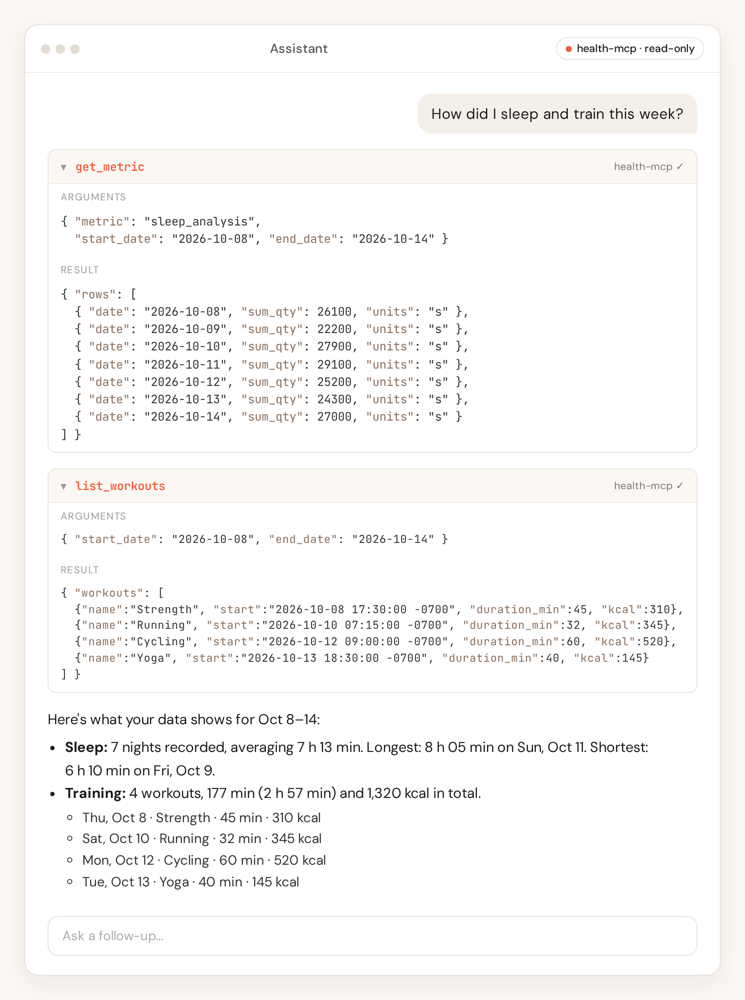

# health-mcp



Ask your AI chatbot about your own health data. health-mcp takes the steps, calories, weight, workouts and nutrition your phone already collects (iPhone or Android) and makes them available to any AI chatbot that supports MCP connectors. It runs on a small server that you own, so your data stays with you.

## How it works

- **Your phone app sends your data.** An export app on your phone (Health Auto Export on iPhone, HC Webhook or Life Dashboard Companion on Android) posts your health data to your server.
- **Your server keeps it.** health-mcp stores one row per metric per day in a database that you control.
- **Your chatbot connects.** You add your server to your chatbot as an MCP connector, and it can read (never change) your daily data.

## Quick start

You need a computer with [Node.js](https://nodejs.org) 22 or newer and a terminal, plus a free [Cloudflare](https://www.cloudflare.com) account. This takes about 15 minutes.

### 1. Deploy your server

The simplest option is Cloudflare Workers with a D1 database. Copy and paste these commands one at a time:

```bash
git clone https://github.com/Airbloomer/health-mcp.git
cd health-mcp
npm install
cp wrangler.example.toml wrangler.toml
npx wrangler login
npx wrangler d1 create health-mcp
```

The last command prints a `database_id`. Open `wrangler.toml` in a text editor and paste that value in place of `replace-with-d1-database-id`. While you are there, change `HEALTH_TIMEZONE` to your own time zone, for example `Europe/Rome`.

Then create the database tables. Do this **before** you deploy:

```bash
npx wrangler d1 migrations apply health-mcp --remote
```

Prefer your own machine, a VPS, or Docker? See [Self-hosting](docs/self-hosting.md) for the Node.js and Docker options (SQLite or Postgres).

### 2. Create your token

The token is the password for your server. Generate a random one:

```bash
openssl rand -hex 32
```

Save it somewhere private, such as a password manager. Then store it on your server and deploy:

```bash
npx wrangler secret put HEALTH_INGEST_TOKEN
npx wrangler deploy
```

Paste the token when `secret put` asks for it. `wrangler deploy` prints your server's address, something like `https://health-mcp.<your-subdomain>.workers.dev`. Below, `<your-host>` means that address without `https://`, and `<HEALTH_INGEST_TOKEN>` means your token.

Anyone with this token can read and write your data. Never share it or post it in a screenshot. More in [Security](docs/security.md).

### 3. Connect your phone

#### iPhone: Health Auto Export

In [Health Auto Export](https://help.healthyapps.dev/en/health-auto-export/automations/rest-api), open **Automations**, tap **New Automation**, choose **REST API**, and set:

- **URL:** `https://<your-host>/ingest`
- **Header:** key `Authorization`, value `Bearer <HEALTH_INGEST_TOKEN>` (the word `Bearer`, a space, then the token)
- **Export format:** JSON, **Export version:** Version 2
- **Data type:** Health Metrics

Create a second automation the same way with data type **Workouts**. Tap **Manual Export** to send your first data. Automations only run while the phone is unlocked. Full details: [Data sources](docs/sources.md#health-auto-export).

#### Android: HC Webhook or Life Dashboard Companion

Both apps read Health Connect, so anything Health Connect already collects (for example from a smart scale or a fitness band app) can be sent. Install one of them, grant it Health Connect read access, and add a webhook:

- **HC Webhook:** URL `https://<your-host>/ingest/hc-webhook`, format JSON.
- **Life Dashboard Companion:** on the **Health** tab, URL `https://<your-host>/ingest/life-dashboard`. Leave **Daily totals in payload** on.

Then add a header with key `Authorization` and value `Bearer <HEALTH_INGEST_TOKEN>`. Run a sync (Life Dashboard Companion: **Test ping**, then **Sync Now**).

**If the app cannot send a header** (for example a URL added by QR pairing in Life Dashboard Companion), use a second, separate token in the URL instead:

```bash
openssl rand -hex 32
npx wrangler secret put HEALTH_INGEST_URL_TOKEN
```

Then paste the path form: `https://<your-host>/ingest/hc-webhook/<HEALTH_INGEST_URL_TOKEN>` (or `/ingest/life-dashboard/<HEALTH_INGEST_URL_TOKEN>`).

> **Security note:** this URL token can only send data, never read it. Still, a URL can end up in logs, history, screenshots and QR codes, and Cloudflare's request logs keep the full URL. Prefer the header when you can. Never put your main `HEALTH_INGEST_TOKEN` in a URL, and if the URL may have leaked, run `npx wrangler secret put HEALTH_INGEST_URL_TOKEN` again with a new value. See [Security](docs/security.md).

Full setup for both apps: [Data sources](docs/sources.md#hc-webhook).

### 4. Connect your chatbot

Every chatbot that supports remote MCP servers needs the same two things:

- **Server URL:** `https://<your-host>/mcp`
- **Authorization header:** `Bearer <HEALTH_INGEST_TOKEN>`

Your server must be reachable on the public internet (the `workers.dev` address is). The connection is read-only: the chatbot cannot change or delete your data.

- **Claude** (web and desktop): go to **Customize > Connectors**, click **Add**, then add a custom connector. Enter a name and the server URL, choose **No sign in**, and under **Request headers** add `Authorization` with the value `Bearer <HEALTH_INGEST_TOKEN>`. Request headers are a beta feature; see [Claude's help article](https://support.claude.com/en/articles/11176164-use-connectors-to-extend-claude-s-capabilities). On Team and Enterprise plans an owner adds the connector first.
- **ChatGPT:** custom MCP servers are added under **Plugins** (plus button, **Add custom MCP server**). At the time of writing, OpenAI's [documentation](https://developers.openai.com/api/docs/guides/custom-mcp-server) lists only OAuth or no authentication, and health-mcp requires a bearer token, so ChatGPT may not be able to connect yet.
- **Cursor and other clients:** add a remote MCP server with the URL and header above. A Cursor `mcp.json` example is in the [API reference](docs/api.md#cursor).

### 5. Try it

Start a new chat with the connector turned on and ask:

- "How many steps did I take yesterday?"
- "Show my weight over the last 30 days."
- "List my workouts from this week and how long each one was."

## Troubleshooting

- **The chatbot says unauthorized, or the app gets `401`.** The header must be exactly `Bearer `, a space, then the token, with no extra spaces. The URL token works only on the two Android webhook routes, never for `/mcp`.
- **Ingest fails right after deploying.** Run `npx wrangler d1 migrations apply health-mcp --remote`, then deploy again.
- **A day is missing or on the wrong date.** Set `HEALTH_TIMEZONE` in `wrangler.toml` to your zone and run `npx wrangler deploy` again.
- **Totals look too low.** Send whole days. A later sync with fewer samples for a day does not replace a fuller one. See [Data sources](docs/sources.md).
- **Nothing arrives from the iPhone.** Health Auto Export runs only while the phone is unlocked. Try **Manual Export**.
- **A browser-based client gets `403`.** Add its origin to `MCP_ALLOWED_ORIGINS`. See [Self-hosting](docs/self-hosting.md#configuration).

## More documentation

- [API reference](docs/api.md): routes, payload formats, limits, and MCP tools
- [Data sources](docs/sources.md): every supported exporter and full app setup
- [Self-hosting](docs/self-hosting.md): Cloudflare, Docker, Node, configuration, migrations, development
- [Security](docs/security.md): tokens, rotation, URL-token caveats, and logs

## Disclaimer

Not affiliated with, endorsed or sponsored by Apple Inc. Apple, Apple Health and HealthKit are trademarks of Apple Inc. Health Auto Export, SyncFit, Health Export Pro, Google, Health Connect, HC Webhook and Life Dashboard Companion are trademarks of their respective owners and are mentioned only to describe compatibility; no endorsement is implied.

Not medical advice and not a medical device. This software is for personal informational use only and is not intended to diagnose, treat or prevent any condition. Consult a qualified professional for medical decisions.

Self-hosted: you run this software and you are responsible for securing your endpoint and your health data. Airbloomer, LLC does not host, receive or access any user data. Provided 'as is' under the MIT License, without warranty.

## Hosted version

We're exploring a hosted health-mcp for people who don't want to run their own server. It isn't available, and there's no commitment to launch it, or to any pricing or timing. To hear if it happens, email oss@airbloomer.com with the subject 'hosted waitlist'. Please don't include any health information in your email. We'll use your email address only to contact you about a hosted version, keep it no longer than 24 months, and delete it sooner if you ask (reply 'remove' at any time). Details: https://airbloomer.com/privacy. Nothing in this section changes the self-hosted software: Airbloomer, LLC still does not host, receive or access any of your health data.

## License

[MIT](LICENSE)
